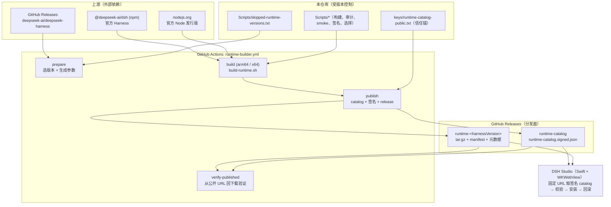

# ARCHITECTURE — DSH-Studio-Runtime

> 基于提交 `7451b68` 的实际代码编写。凡涉及客户端（DSH Studio）的事实来自 2026-10-11 的只读代码审计，
> 均标注来源文件；未能验证的一律标注「待确认」。

## 1. 系统全景



## 2. 模块与职责

| 模块 | 文件 | 职责 |
| --- | --- | --- |
| 版本选择 | `Scripts/select-next-runtime-version.sh` | 纯文本、无网络：应用 floor、已发布集合与跳过列表，输出候选（升序）+ 诊断（stderr） |
| 构建 | `Scripts/build-runtime.sh` | 校验输入 → 下载校验 Node → 安装 Harness+pnpm → 依赖审计 → 原生校验 → 生成 manifest → 打包 → 计算 SHA-256 → **解包并对产物跑 smoke** → 写元数据 |
| 依赖审计 | `Scripts/audit-dependencies.js` | 锁文件里出现未登记的 install/gypfile 包即失败（白名单逐条给出理由） |
| Smoke | `Scripts/runtime-smoke.sh` | 在解包产物上：布局/架构（`lipo`）、原生加载、pty 实跑、封印（sandbox/credentials）加载、koffi 版本对 pin、插件市场实装、Harness 启动 + `settings/describe`、SIGTERM、进程树清理 |
| 进程树库 | `Scripts/lib/process-tree.sh` | 记录 descendants、断言全部退出、best-effort 清理（只动本次观测到的 PID） |
| Catalog 生成 | `Scripts/generate-runtime-catalog.sh` | 复核两架构产物的字节/大小/命名/契约字段，生成 catalog payload |
| 防降级 | `Scripts/check-catalog-precedent.sh` | 拒绝版本回退；同版本重打包放行并注明替换 |
| 签名 | `Scripts/sign-runtime-catalog.sh` | Ed25519 签名；**强制派生公钥 == 已提交锚**；私钥只经环境变量/文件，绝不进 argv |
| 验签 | `Scripts/verify-runtime-catalog.sh` | 校验锚长度、信封/ payload schema、keyID、签名 |
| 发布后验证 | `Scripts/verify-published-runtime.sh` | 从公开 URL 回下载 catalog + 两个产物，验签 + SHA-256 + 大小 + URL 形状 |
| 插件市场解析 | `Scripts/resolve-plugin-market.js` | 按客户端范围语义挑选与 Harness 兼容的市场版本，写入 manifest/catalog（**职责收敛中，见 DIGEST**） |
| 测试 | `Scripts/run-tests.sh` + `Scripts/tests/` | 113 项离线测试（fixture 驱动，无网络、无密钥、不需要 macOS） |
| CI | `.github/workflows/runtime-builder.yml` / `verify.yml` | 发布流水线 / PR 门禁 |

## 3. 关键数据结构（都是**自建**，不是上游格式）

### 3.1 archive 内 manifest（`schemaVersion: 3`）

```json
{
  "schemaVersion": 3,
  "runtimeVersion": "0.2.1-alpha.2",   // == harnessVersion
  "platform": "macos",
  "architecture": "darwin-arm64",
  "nodeVersion": "24.19.0",
  "harnessVersion": "0.2.1-alpha.2",
  "pnpmVersion": "11.22.0",
  "nodeSHA256": "…",
  "harnessPackageIntegrity": "sha512-…",
  "pnpmPackageIntegrity": "sha512-…",
  "registry": "https://registry.npmjs.org",
  "dependencyLockSHA256": "…",
  "pluginMarket": { "package": "dshmarket", "version": "1.66.14", "integrity": "sha512-…", "harnessRange": "…" },
  "dataFormat": { "id": "sqlite-v2", "compatibleWith": [], "migration": null },
  "provenance": { "commit": "…", "ref": "…", "runId": "…" }
}
```

**注意**：archive 内 manifest **不可能**包含自身归档的 sha（自引用悖论）。字节身份只出现在**发布侧的
元数据文件**（作为 release 附件上传，不进 archive）里：

```json
// artifact-<runtimeVersion>-<arch>.json（release 附件，archive 之外）
{ "runtimeVersion": "…", "platform": "macos", "architecture": "darwin-arm64",
  "nodeVersion": "…", "harnessVersion": "…", "pnpmVersion": "…",
  "nodeArchiveSHA256": "…", "harnessPackageIntegrity": "…", "pnpmPackageIntegrity": "…",
  "dependencyLockSHA256": "…", "provenance": {…}, "pluginMarket": {…}, "dataFormat": {…},
  "artifact": "dsh-runtime-<v>-<arch>.tar.gz", "sha256": "…", "size": 0, "url": "https://…",
  "manifest": "manifest-<v>-<arch>.json" }
```

### 3.2 catalog payload（`schemaVersion: 1`）

```json
{ "schemaVersion": 1, "runtimeVersion": "0.2.1-alpha.2",
  "releases": [ { "runtimeVersion": "…", "platform": "macos", "architecture": "darwin-arm64",
                  "nodeVersion": "…", "harnessVersion": "…", "pnpmVersion": "…",
                  "nodeArchiveSHA256": "…", "harnessPackageIntegrity": "…", "pnpmPackageIntegrity": "…",
                  "dependencyLockSHA256": "…", "pluginMarket": {…}, "dataFormat": {…},
                  "artifact": { "runtimeVersion": "…", "architecture": "…", "url": "https://github.com/…/releases/download/runtime-<v>/dsh-runtime-<v>-<arch>.tar.gz", "sha256": "…", "size": 0 } } ] }
```

**每架构恰好一条 release**（客户端要求）。`artifact.sha256` 是**唯一的构建身份**（客户端据此认证字节）。

### 3.3 签名信封（`schemaVersion: 1`）

```json
{ "schemaVersion": 1, "keyID": "runtime-catalog-v1", "payload": "<base64>", "signature": "<base64 Ed25519>" }
```

## 4. 主要数据流

**构建与发布**（`.github/workflows/runtime-builder.yml`）：

```text
cron/dispatch/tag
  → prepare：上游 release 列表（按 published_at 升序）→ select-next-runtime-version.sh（floor + 已发布 + 跳过列表）
             → 对候选依次做 npm 可用性检查 → 选定一个版本（每次运行最多一版）
  → build ×2 架构：build-runtime.sh（每条架构独立）→ 解包后跑 runtime-smoke.sh
  → publish：generate-runtime-catalog.sh（复核字节）→ check-catalog-precedent.sh（防降级）
             → sign-runtime-catalog.sh（对锚校验）→ 先传产物、后传 catalog
  → verify-published：verify-published-runtime.sh（公开 URL 回下载：验签 + SHA-256 + 大小 + URL 形状）
```

**客户端安装**（DSH Studio，只读审计结论）：

```text
固定 URL 取 runtime-catalog.signed.json（缓存于 RuntimeManifest/）
  → 用内置公钥验签（RuntimeCatalogTrust.publicKeyData，来自 Info.plist）
  → 选版本/架构 → 下载产物到 RuntimeDownloads/<sha256>.tar.gz
  → 校验 SHA-256（= catalog 声明值）→ 解包到 staging（.Runtime-<uuid>）
  → 校验 manifest 与 catalog 一致 → 启动 → 健康检查（settings/describe）
  → 通过后才写 active-state.json（durable 激活）→ 失败则回滚到上一版
```

## 5. 对外接口（契约面，改动即破坏客户端）

| 接口 | 值 | 稳定性 |
| --- | --- | --- |
| catalog URL | `https://github.com/SteveTanSaMa/DSH-Studio-Runtime/releases/download/runtime-catalog/runtime-catalog.signed.json` | 冻结 |
| release tag | `runtime-<harnessVersion>` | 冻结 |
| 附件名 | `dsh-runtime-<harnessVersion>-<arch>.tar.gz` | 冻结 |
| archive 根布局 | `manifest.json`、`node/`、`harness/`（不允许额外成员，尤其 macOS 元数据） | 冻结 |
| manifest / catalog / 信封 schemaVersion | 3 / 1 / 1 | 冻结 |
| 信任锚 | 仓库 `keys/runtime-catalog-public.txt` + 客户端 `Info.plist`（`RUNTIME_CATALOG_PUBLIC_KEY`），keyID `runtime-catalog-v1` | 换锚需发新版 App |

详细语义见 `docs/runtime-contract.md`（权威）。

## 6. 重要技术决策（摘要，完整见 `DECISIONS.md`）

1. **Runtime 版本 == Harness 版本**（`0.2.0-rc.1` 起）；身份由 `artifact.sha256` 承担。
2. **同版本重打包 = 例外恢复机制**（不是日常更新策略），只替换附件、不新增 release。
3. **签名 catalog + 客户端内置信任锚**，fail closed；换锚必须伴随 App 发版。
4. **依赖闭包禁用 install scripts**，显式构建的包由构建脚本处理，新增脚本包必须显式登记。
5. **数据兼容性**目前用自建 `dataFormat`，**已知与事实不符**（真实为 session format v4 / jsonl.zstd），
   修正方案已设计但**未实施**（见 `docs/data-compatibility-contract.md`）。
6. **插件市场 pin** 是"经过验证的组合"记录，解析语义与客户端重复，职责收敛方案待跨仓库协调。

## 7. 运行环境与依赖

- **CI**：GitHub Actions；`prepare` 与 `verify-published` 在 ubuntu，`build`/`publish` 在 macOS。
  `publish` 使用 environment `runtime-signing`（唯一能看到私钥的 job）。
- **本地**：macOS + bash 3.2+ + node；离线套件不需要网络、密钥或 GitHub。
- **第三方依赖**：① 官方 Node 发行版（校验和验证）② npm 上的 `@deepseek-ai/dsh` 与 `pnpm`
  ③ 运行期的原生模块 `node-pty`（prebuild）、`koffi`（平台 optional 包，上游精确 pin）④ 签名用 Node 内置
  `crypto`（无第三方加密库）。**本仓库不引入任何运行时服务或数据库。**

## 8. 已知架构限制

- **不宣称字节级可复现**：每次构建重新解析依赖图 + 打包时间戳变化；身份靠"已发布的那份字节 + SHA-256"。
- **x64 未经真实 Intel 硬件验证**（Apple Silicon + Rosetta 构建/测试）。
- **构建机完全可信**：没有可复现构建，因此无法用重建发现"构建环境被入侵"。
- **客户端缺口需跨仓库修复**（只读审计发现）：不持久化 `artifact.sha256`；同版本 repack 时缓存优先会
  导致永久校验失败；staging 目录无启动清理。
